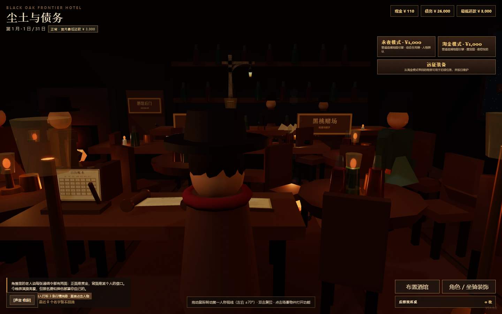

# 尘土与债务 · Dust & Debt

**在西部荒野追捕赏金，在每个月末面对债主。**

一个可以在 **Chrome 浏览器直接游玩**的西部题材游戏。酒馆是你的起点，赏金、追捕、坐骑、情报、淘金与债务交织成一段边境生活。

> **本游戏完全使用 GPT 5.6 sol 制作。**
>
> 这是创作者提供的制作说明。本仓库保留游戏原始 HTML 与历史版本，展示游戏的持续迭代过程。


## 开始游玩

- **在线入口**：[https://cnsdqd-dyb.github.io/dust-and-debt/](https://cnsdqd-dyb.github.io/dust-and-debt/)。
- **本地试玩**：下载并解压本仓库，双击 [尘土与债务_V51.5.2_道路六向资源与地图入口修复版.html](versions/%E5%B0%98%E5%9C%9F%E4%B8%8E%E5%80%BA%E5%8A%A1_V51.5.2_%E9%81%93%E8%B7%AF%E5%85%AD%E5%90%91%E8%B5%84%E6%BA%90%E4%B8%8E%E5%9C%B0%E5%9B%BE%E5%85%A5%E5%8F%A3%E4%BF%AE%E5%A4%8D%E7%89%88.html)，用 Chrome 打开。
- **版本选择**：[完整版本档案](VERSIONS.md)，或者打开项目根目录的 `index.html`。

部分 3D 酒馆内容使用 CDN 上的 Three.js 与模型资源，首次加载建议联网。声音通常需要点击页面后才会播放。建议使用电脑横屏体验。

## 荒野里有什么

| 体验 | 你会面对的选择 |
| --- | --- |
| 西部酒馆与赏金任务 | 获取情报，挑选目标，准备出发 |
| 债务与生存 | 在现金、生命、还款期限之间寻找余地 |
| 骑马与追捕 | 选择坐骑，在荒野与追捕者交锋 |
| 淘金与探索 | 寻找藏宝线索，挖掘资源，探索自然地貌 |
| 边境生活 | 体验赌场、市场、装备与酒馆里的各种事件 |

以上介绍根据推荐版本的游戏代码整理，具体规则以游戏内说明为准。

## 游戏实机画面



## 新玩家建议

进入游戏后先查看开局难度和游戏内提示，再熟悉现金、债务与日期。操作以游戏内显示为准；键盘移动和交互提示会随场景变化。

游戏使用浏览器 `localStorage` 保存进度。不同浏览器、网站地址和本地文件可能对应不同存档；清理网站数据会影响存档。游戏内提供导入 / 导出时，建议先导出备份，再切换历史版本。

## 保留每一步迭代

本项目归档 **38 份 HTML 原件**，覆盖 V33、V35、V44、V45、V49.3、V50 系列和 V51 系列等版本，并保留早期修复版与视觉设定表。原文件均不改写，默认入口指向你指定的 **V51.5.2 · 道路六向资源与地图入口修复版**。

- [全部版本及下载](VERSIONS.md)
- [归档清单](versions/manifest.json)
- [SHA-256 校验值](versions/SHA256SUMS.txt)

## 项目结构

```text
index.html            游戏宣传首页、推荐试玩和版本选择
README.md             项目介绍
VERSIONS.md           全部版本目录
versions/             原始游戏 HTML、设定表与校验清单
docs/                 实机截图、宣传文字与可选部署示例
```

## 分享与反馈

如果你喜欢这个游戏，欢迎给项目点一个 Star，把试玩链接分享给朋友。在 Issues 中反馈时，请附上版本名、Chrome 版本、复现步骤，以及截图或报错信息。不要附带私人存档信息。

**分享文案**：一款完全使用 GPT 5.6 sol 制作的西部浏览器游戏《尘土与债务》：在酒馆接赏金、骑马闯荒野、淘金求生，还要赶在月底还清债务。Chrome 即可试玩，历次版本完整保留。

## 制作与资源说明

游戏制作说明：**完全使用 GPT 5.6 sol 制作**。项目整理、版本归档与宣传页面为本次发布准备内容。

原游戏引用 Three.js 与 KhronosGroup 示例模型等外部资源，其权利归各自权利人所有。这个制作声明不表示第三方库或模型也由 GPT 5.6 sol 原创。当前未指定开源许可证，复用与再分发需取得相应授权。
