[English](https://github.com/cnsdqd-dyb/dust-and-debt/blob/main/README.md) · **简体中文**

# 🤖 AI 快速做出一款真正可玩的高质量游戏，离我们还有多远？

> *荒野给你机会，账本催你还债。*

**《尘土与债务》是一场可以亲手试玩的实验，游戏完全使用 GPT 5.6 sol 制作。** 我们想回答一个很具体的问题：AI 能否越过演示和原型，快速做出一款有深度、有风格，而且真的让人愿意玩的游戏？

目前的答案是：**AI 已经可以比过去快得多地抵达“内容丰富、可以认真玩”的阶段；要稳定抵达“高质量”，依然需要持续的判断、测试与打磨。** 这个仓库保留了游戏、截图和迭代记录，你不必相信宣传，可以直接试玩后给出自己的答案。

**[⚔️ 试玩英文 Beta](https://cnsdqd-dyb.github.io/dust-and-debt/editions/dust-and-debt-v51.5.2-en-beta.html) · [🏮 试玩中文原版](https://cnsdqd-dyb.github.io/dust-and-debt/versions/%E5%B0%98%E5%9C%9F%E4%B8%8E%E5%80%BA%E5%8A%A1_V51.5.2_%E9%81%93%E8%B7%AF%E5%85%AD%E5%90%91%E8%B5%84%E6%BA%90%E4%B8%8E%E5%9C%B0%E5%9B%BE%E5%85%A5%E5%8F%A3%E4%BF%AE%E5%A4%8D%E7%89%88.html) · [📥 下载游戏](https://github.com/cnsdqd-dyb/dust-and-debt/releases/tag/v51.5.2) · [📚 浏览全部 38 份原件](VERSIONS.md)**

推荐版本：**V51.5.2** · 推荐电脑 Chrome 横屏体验 · 英文 Beta 已覆盖主要流程，少量事件文本可能仍为中文。

---

## 🧭 AI 到底做出了什么？

这不是一组彼此无关的小演示，而是一款系统互相影响的浏览器游戏：

| 实际可玩的内容 | 它对这场实验意味着什么 |
| --- | --- |
| 96×96 荒野，包含道路、河流、地形、天气与旅行资源 | AI 组合出了会互相影响的系统，而不只是一张场景图 |
| 悬赏、藏宝图、淘金与永夜远征 | 游戏拥有多条完整的风险与收益循环 |
| 坐骑、马厩、换装与可布置的 3D 酒馆 | 成长不只是数字，也包含拥有感与个性表达 |
| 赛马、赌场、轮盘、左轮赌局与金融市场 | 不同玩法最终汇入同一套现金与债务经济 |
| 浏览器存档、进度导出与 38 份源文件快照 | 项目经历了真实迭代，而且过程可检查、可追溯 |

下面的图片全部来自 V51.5.2 实机。它们展示 AI 已经抵达的玩法广度，仓库也保留了实现细节和仍需改进的部分。

## 🗺️ 证据一 · 一片值得穿越的荒野

道路、河流、农田和复杂地形会影响路线。天气、体力与补给让地图真正参与玩法，而不只是背景。

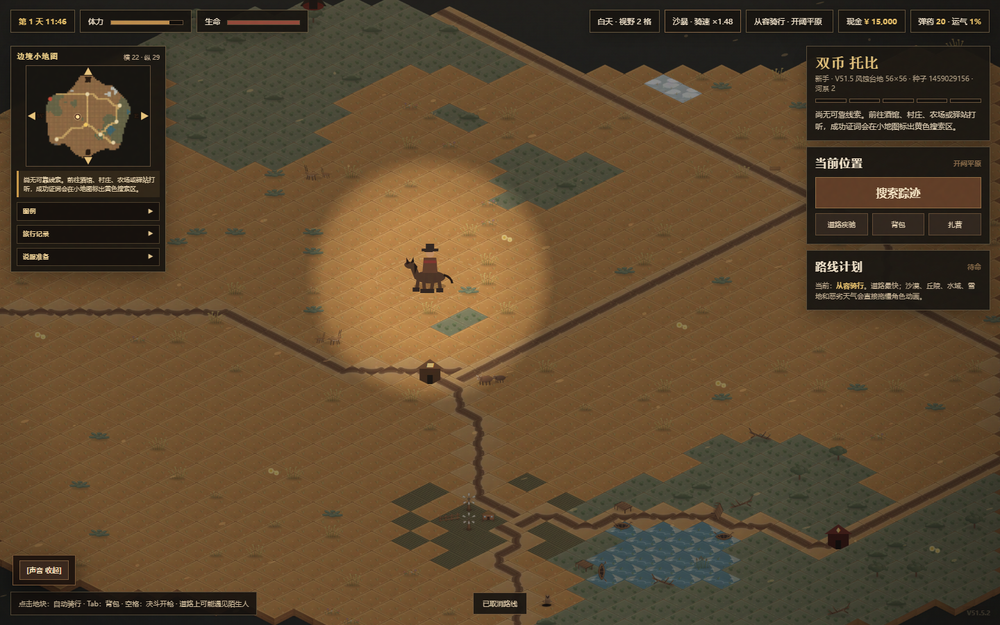

## 📜 证据二 · 悬赏、藏宝与远征

选择通缉目标，签下淘金契约，循藏宝图寻宝，或者进入永夜。战利品只有活着带回家才真正属于你。

<table><tr><td width="50%" valign="top"><a href="docs/screenshots/bounty-board.webp">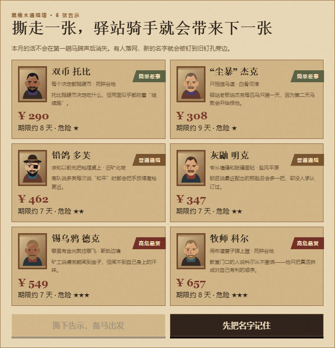</a><h4>📜 挑选悬赏目标</h4>
比较通缉令、赏金和目标信息，再决定追谁。
</td><td width="50%" valign="top"><a href="docs/screenshots/gold-rush.webp">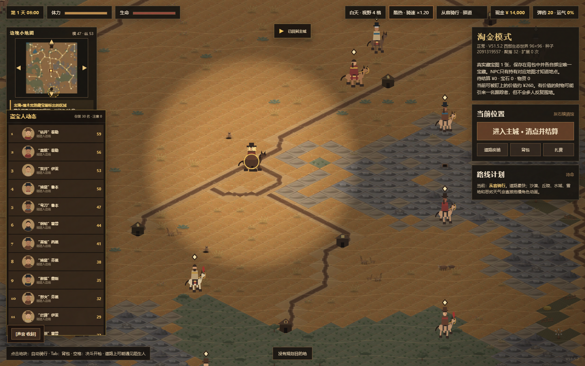</a><h4>💰 去荒野追一笔横财</h4>
探索聚落，与其他寻宝人竞争，再把财富活着带回家。
</td></tr></table>

<table><tr><td width="50%" valign="top"><a href="docs/screenshots/treasure-map.webp">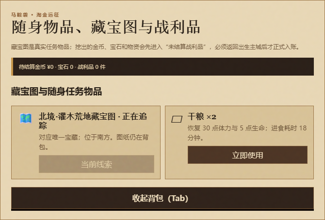</a><h4>🗺️ 循着真实线索寻宝</h4>
每张图指向一份宝藏，但找到它只是旅程的一半。
</td><td width="50%" valign="top"><a href="docs/screenshots/endless-night.webp">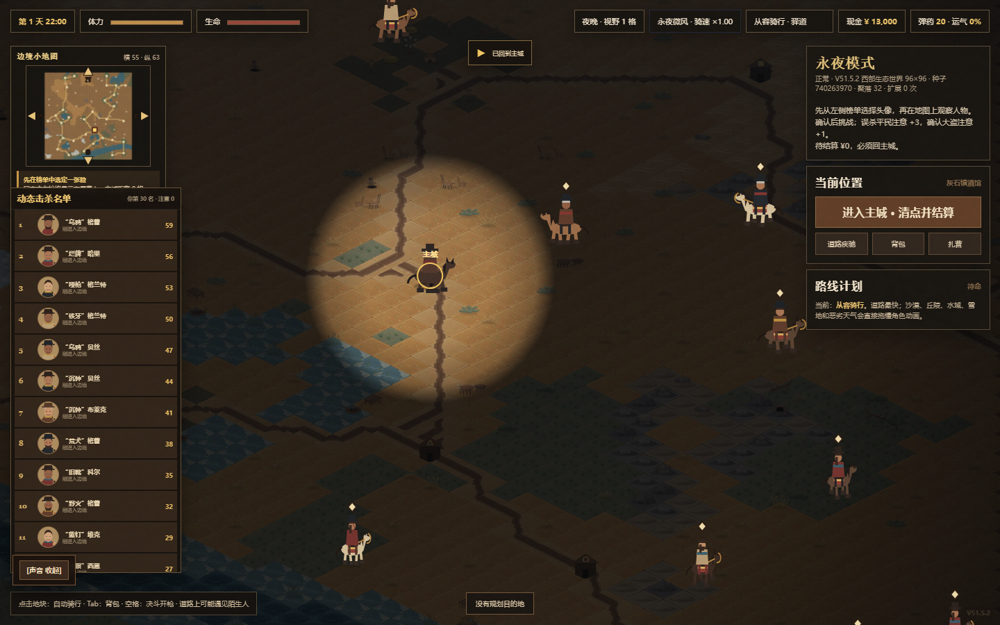</a><h4>🌙 在永夜中生存</h4>
动态亡命徒活动，让熟悉的边境拥有另一种节奏。
</td></tr></table>

## 🐎 证据三 · 坐骑和属于自己的据点

购买坐骑、管理马厩、给猎人换装，还能亲手布置 3D 酒馆。远征之间的生活让旅途拥有归属感。

<table><tr><td width="50%" valign="top"><a href="docs/screenshots/mount-market.webp">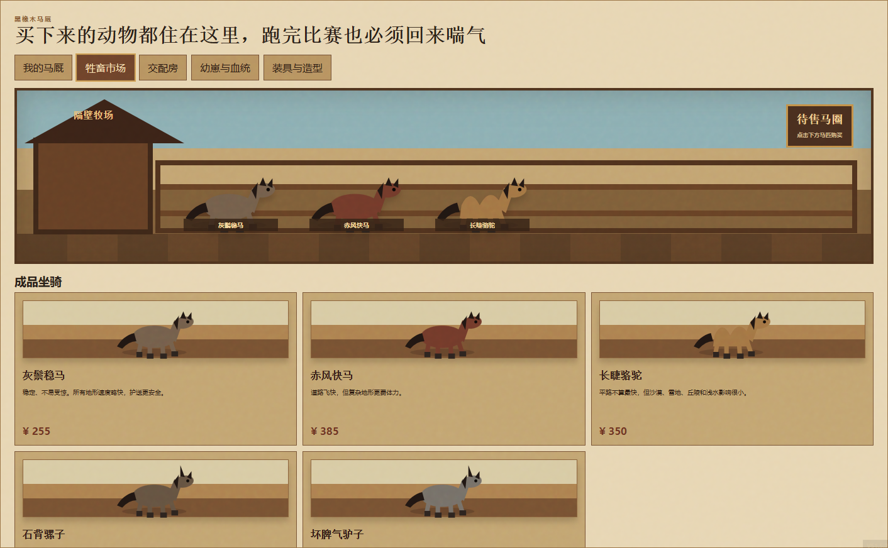</a><h4>🐎 选择旅行伙伴</h4>
比较动物和价格，再决定怎样花掉辛苦挣来的钱。
</td><td width="50%" valign="top"><a href="docs/screenshots/stable.webp">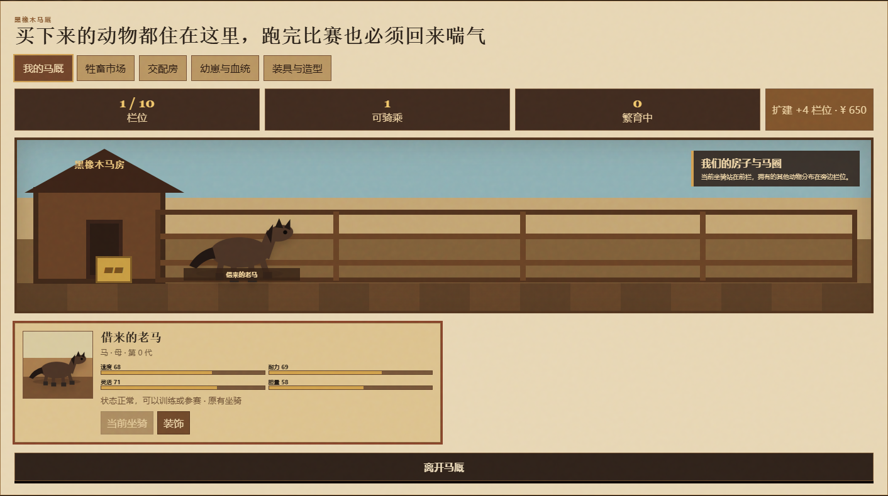</a><h4>🌾 管理自己的马厩</h4>
查看并管理陪你进入荒野的伙伴。
</td></tr></table>

<table><tr><td width="50%" valign="top"><a href="docs/screenshots/wardrobe.webp">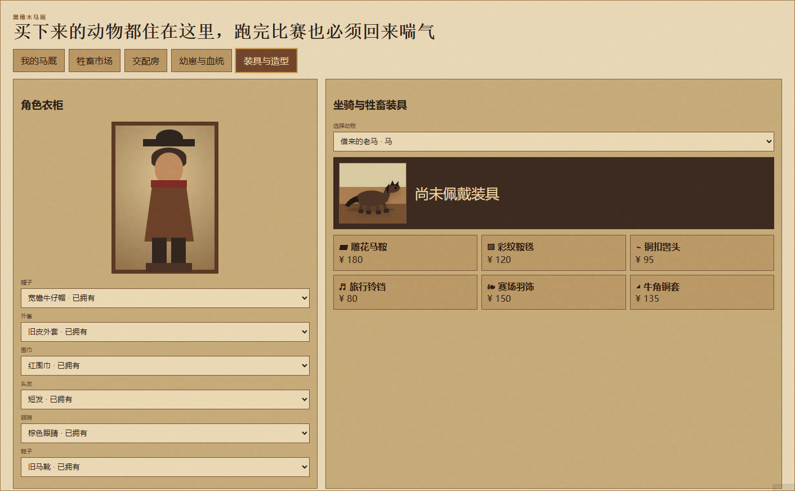</a><h4>🤠 给猎人换一身行头</h4>
定制角色和坐骑，再带着自己的风格回到酒馆。
</td><td width="50%" valign="top"><h4>🏚️ 把酒馆变成自己的家</h4>
使用游戏内 3D 布置工具选择和摆放物件。
</td></tr></table>

## 🏇 证据四 · 风险汇成同一本账

去赛马、转轮盘、坐上左轮赌桌，或者研究金融市场。每种选择最终都回到同一份现金和月末债务。

<table><tr><td width="50%" valign="top"><a href="docs/screenshots/race-selection.webp">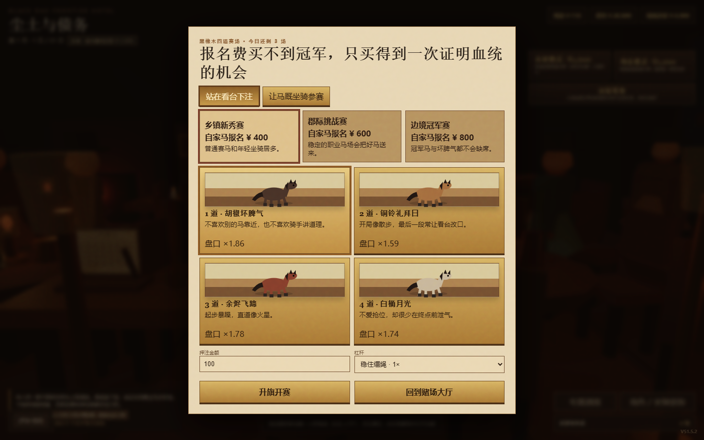</a><h4>🏇 先读懂赛场</h4>
比较参赛马和赔率，再决定筹码押在哪里。
</td><td width="50%" valign="top"><a href="docs/screenshots/race-result.webp">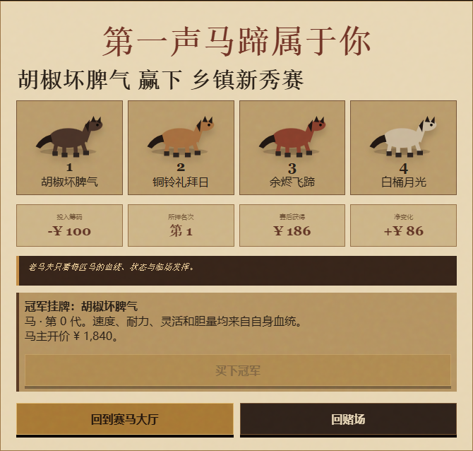</a><h4>🏆 等结果落地</h4>
领奖台、下注与净收益一起揭晓，让每次选择都有分量。
</td></tr></table>

<table><tr><td width="50%" valign="top"><a href="docs/screenshots/casino.webp">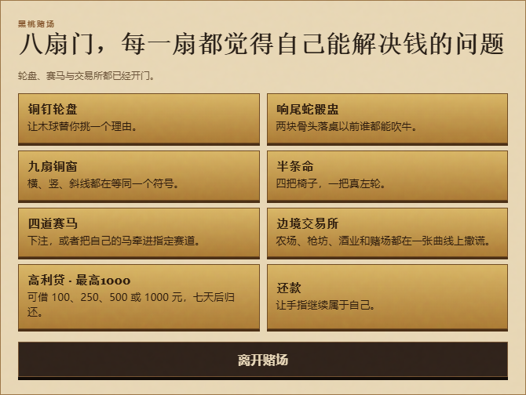</a><h4>🎰 挑一张赌桌</h4>
多种玩法引诱你试试运气，债务账本却始终在走。
</td><td width="50%" valign="top"><a href="docs/screenshots/roulette.webp">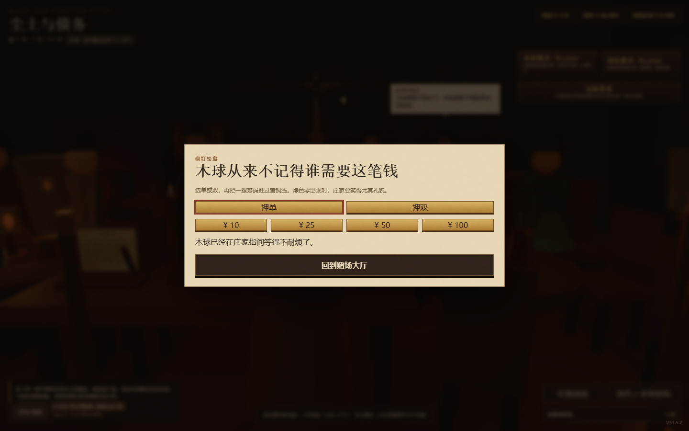</a><h4>🎡 让轮盘决定</h4>
选定下注，看运气是否跑得过下一次还款日。
</td></tr></table>

<table><tr><td width="50%" valign="top"><a href="docs/screenshots/revolver-table.webp">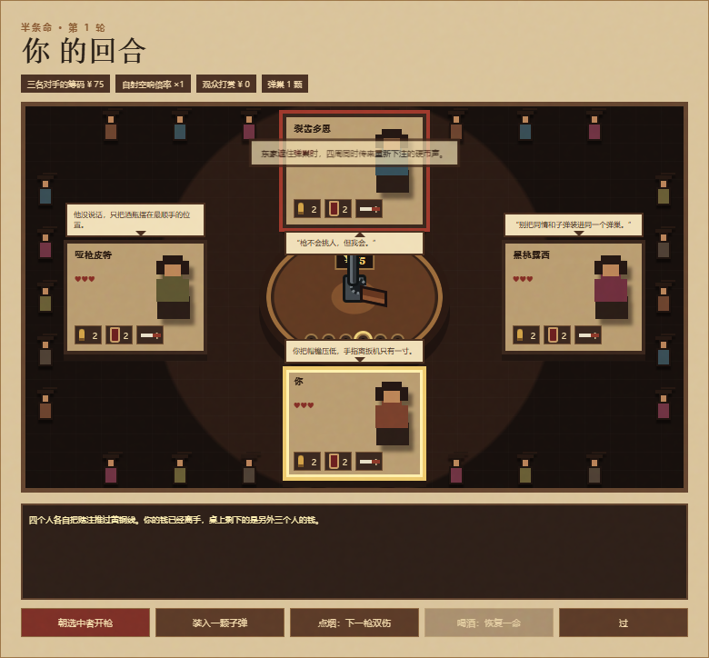</a><h4>⚔️ 把筹码抬到更高</h4>
对手、道具和性命，在同一张紧张的赌桌上相遇。
</td><td width="50%" valign="top"><a href="docs/screenshots/market.webp">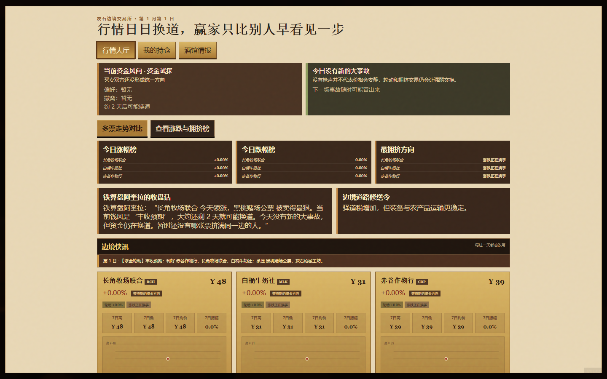</a><h4>💹 寻找另一条赚钱路</h4>
荒野不挣钱时，就来查看行情和交易选择。
</td></tr></table>

## 🍺 证据五 · 把所有玩法连起来的酒馆

每次远征都从酒馆开始，也在这里结束。壁炉、告示、家具和债务账本，把分散的活动连成同一种边境生活。

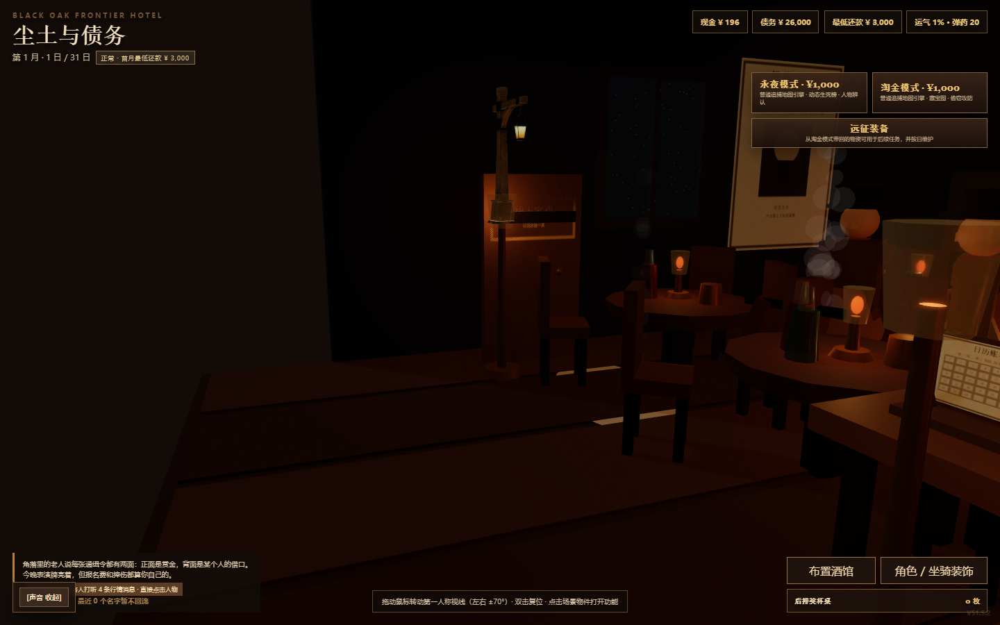

**📸 共 16 张真实游戏截图。** 点击图片查看原尺寸，也可以打开[可筛选的在线画廊](https://cnsdqd-dyb.github.io/dust-and-debt/zh.html#gallery)。部分远征画面使用内置测试资金和全图视野，具体见[截图说明](docs/SCREENSHOTS.md)。

## ⚖️ 所以，我们到底还有多远？

这个项目说明，从想法抵达一款**真正可玩的游戏**，距离已经明显缩短。GPT 5.6 sol 做出了有辨识度的世界、多套相互连接的系统，以及足以让玩家形成策略、偏好和故事的内容。

距离一款**稳定的高质量游戏**，仍然能看见这些路程：

- 玩法广度需要形成连贯节奏，而不只是功能数量。
- 长尾问题需要反复跑不同路线、不同存档才能发现。
- 操作、反馈、引导与无障碍体验需要细致的产品判断。
- 本地化需要结合语境审核，不能只替换文字。
- 性能和外部资源需要进一步打包，才能可靠离线运行。
- 什么该删、该简化、该继续打磨，仍然取决于审美和取舍。

AI 已经让有野心的游戏创作更容易抵达。剩下的工作越来越集中在方向、评估与用心程度上。**请直接玩一遍，再判断这段距离已经缩短了多少。**

## 📚 一份公开的迭代记录

**38 份 HTML 原件全部原样保留**：37 份游戏版本和 1 份视觉设定表，覆盖 V33 至 V51。推荐版本是 **V51.5.2 · 道路六向资源与地图入口修复版**。

- [📖 完整版本总表](VERSIONS.md)
- [🗃️ 原文件清单](versions/manifest.json)
- [🔐 SHA-256 校验](versions/SHA256SUMS.txt)
- [🐎 打开推荐中文版本](https://cnsdqd-dyb.github.io/dust-and-debt/versions/%E5%B0%98%E5%9C%9F%E4%B8%8E%E5%80%BA%E5%8A%A1_V51.5.2_%E9%81%93%E8%B7%AF%E5%85%AD%E5%90%91%E8%B5%84%E6%BA%90%E4%B8%8E%E5%9C%B0%E5%9B%BE%E5%85%A5%E5%8F%A3%E4%BF%AE%E5%A4%8D%E7%89%88.html)

## 🌙 出发前

推荐使用电脑 Chrome 横屏体验。首次加载请联网，因为 3D 酒馆会读取 Three.js 和外部模型资源。声音可能要在第一次点击后播放。进度保存在浏览器 `localStorage` 中；切换版本、网址或浏览器前，请先在游戏内导出存档。

## 🛠️ 制作声明

**本游戏完全使用 GPT 5.6 sol 制作。** 中英双语展示页和版本档案随这次公开发布整理。第三方库与模型的权利归各自权利人；这里的制作声明描述游戏创作过程，不代表外部资源也由 GPT 5.6 sol 原创。当前尚未指定开源许可证。

## ⭐ 一起回答这个问题

如果这场实验让你重新思考 AI 做游戏的边界，欢迎为仓库点一个 **Star**、分享试玩地址，并告诉我们哪里已经像一款真正的游戏，哪里仍然会让体验中断。问题和建议可以提交到 [Issues](https://github.com/cnsdqd-dyb/dust-and-debt/issues)。

⚔️ *愿你的马鞍稳当，愿你的账本宽容。*
